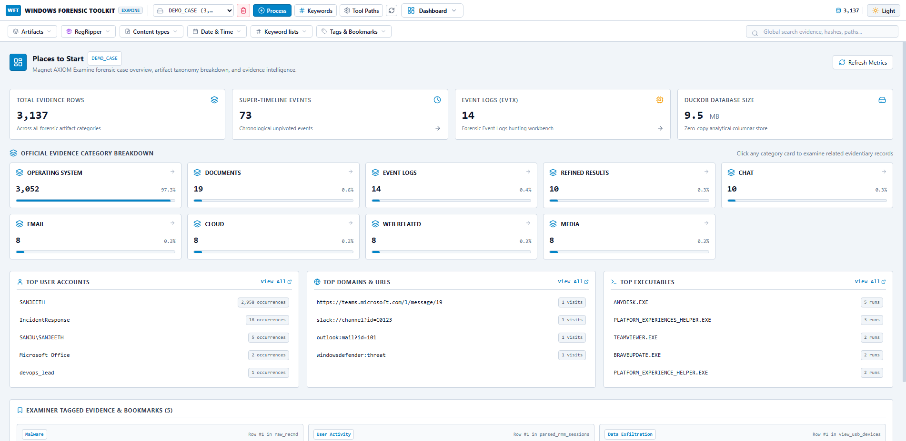
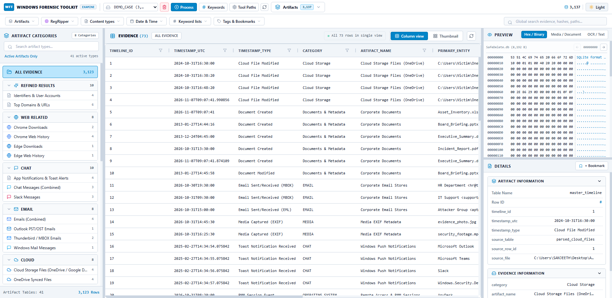
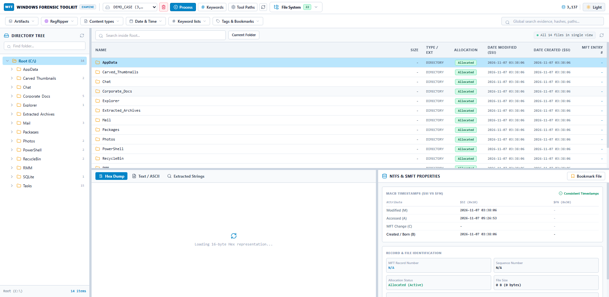
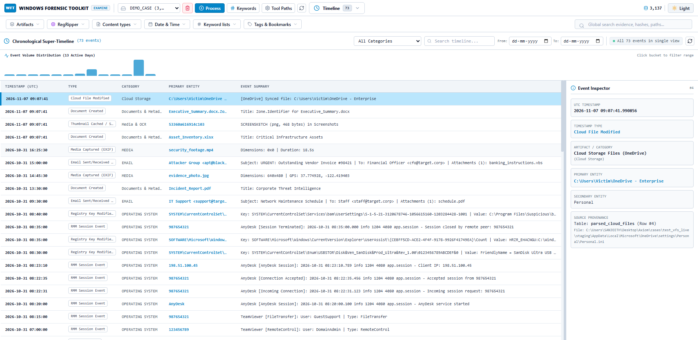
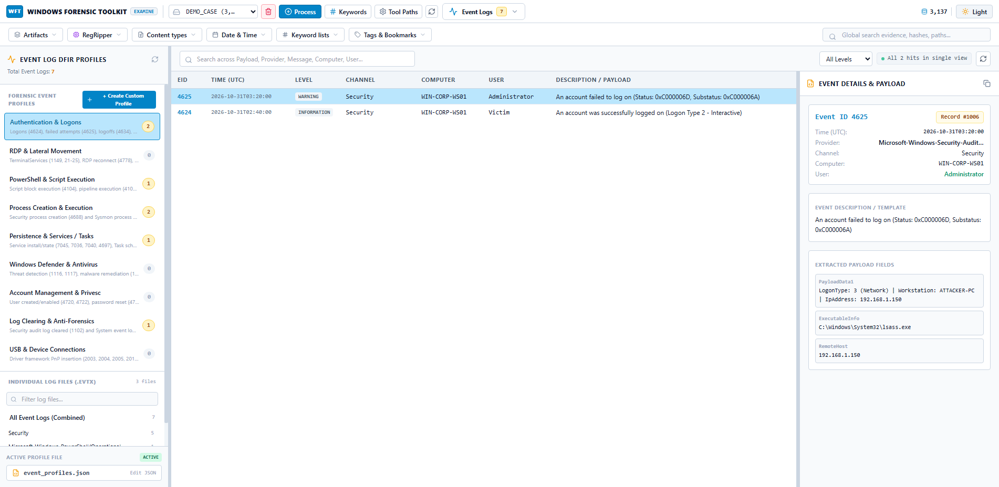
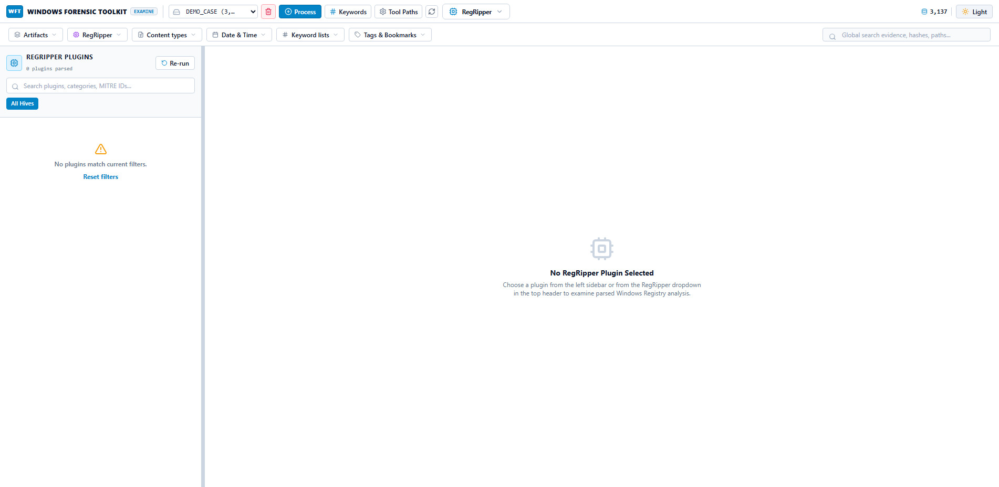
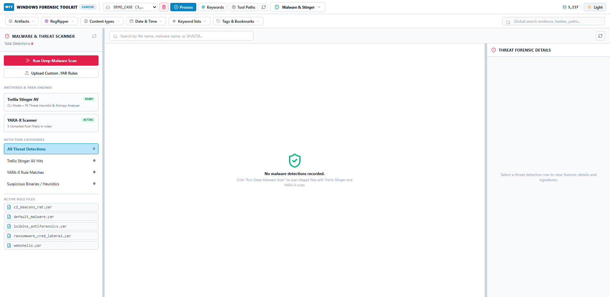
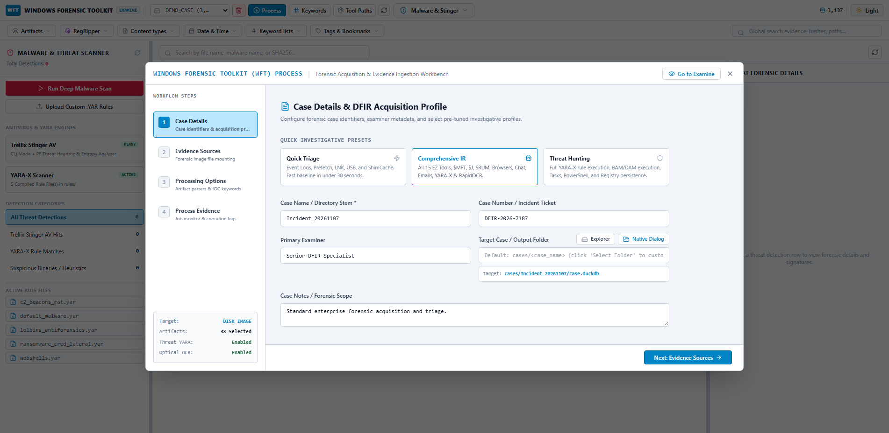

# WFT — Windows Forensic Examination Platform
### Enterprise Windows Digital Forensics & Incident Response (DFIR) Suite (Process + Examine)

[](https://microsoft.com)
[](https://duckdb.org)
[](https://fastapi.tiangolo.com)
[](https://react.dev)
[](#features)

---

## 📌 Overview

**WFT** is an enterprise-grade, full-featured Windows Digital Forensics and Incident Response (DFIR) platform. It seamlessly integrates evidence ingestion, VFS mounting, dirty registry log replay, external CLI orchestration, non-EZ forensic parsing, YARA-X scanning, and RapidOCR into an unified analytics workstation.

WFT operates on a zero-copy, in-process **DuckDB** columnar database engine, providing sub-millisecond query execution, live multi-timestamp super-timelines, interactive entity graph correlation, and an integrated 16-byte Hex & ASCII inspector.

---

## 📸 Screenshots & Interface

### 1. Case Dashboard & Places to Start
High-level forensic intelligence dashboard highlighting high-value artifacts, threat indicators, top executing binaries, and category breakdowns.


### 2. Curated Artifacts Explorer & Data Grid
Virtualized data grid mapping raw forensic records to human-readable columns with smart file icons, multi-column filters, column toggles, and instant tag indicators.


### 3. NTFS File System Tree & Inspection
FTK Imager-style nested folder tree inspection exploring NTFS $MFT directories, file attributes, created/modified timestamps ($SI & $FN), and file reference addresses.


### 4. Unified Chronological Super-Timeline
Multi-timestamp super-timeline unpivoted across all artifact timestamp columns with date histogram aggregation and color-coded event series.


### 5. DFIR Event Logs Workbench
Specialized Event Log investigator with pre-built forensic channel profiles (Security, PowerShell, Sysmon, TaskScheduler, Defender) and Event ID (EID) filters.


### 6. RegRipper 4.0 Fast Plugin Analysis
Automated registry hive runner executing Harlan Carvey's RegRipper 4.0 plugins against SYSTEM, SOFTWARE, SAM, SECURITY, and NTUSER.DAT hives with instant full-text search.


### 7. Malware & Threat Hunting Engine
Compiled YARA-X signature scanning for webshells, beacons, mimikatz, credential dumpers, and Trellix Stinger antivirus detection.


### 8. Evidence Intake & Processing Console
Step-by-step evidence processing wizard for disk image selection, artifact module toggling, target DuckDB storage customization, and real-time execution logs.


---

## 🚀 Key Features

### 1. Evidence Intake & Virtual File System (VFS)
- **Disk Image Mounting:** Direct forensic extraction from `.E01`, `.Ex01`, `.VHDX`, `.VHD`, `.VMDK`, `.RAW`, `.DD`, and `.ISO` disk containers via native `dissect.target` VFS.
- **Triage Directories & Live OS:** Seamless extraction from mounted forensic drives, triage folders, and live triage collection bundles.
- **Flexible DuckDB Case Storage:** Choose any custom target folder or drive to store `case.duckdb` and staging data without cluttering host application folders.

### 2. Eric Zimmerman CLI Tools Orchestration
- **RLA (`rla.exe`):** Mandatory automatic dirty registry transaction log replay (`.LOG1` / `.LOG2`) before any registry analysis.
- **PECmd (`PECmd.exe`):** Windows Prefetch file parsing with run counts, volume serials, and previous execution timestamps.
- **MFTECmd (`MFTECmd.exe`):** Deep NTFS metadata extraction for `$MFT`, `$J` (USN Journal), and `$LogFile`.
- **EvtxECmd (`EvtxECmd.exe`):** Windows EVTX event log parsing with dynamic map resolution.
- **RECmd (`RECmd.exe`):** Registry batch extraction (USBSTOR, MountedDevices, UserAssist, Run/RunOnce, Services, BAM/DAM).
- **LECmd (`LECmd.exe`):** Shell LNK shortcut parsing with target paths and drive serial numbers.
- **JLECmd (`JLECmd.exe`):** Jump Lists (`AutomaticDestinations` & `CustomDestinations`).
- **AmcacheParser (`AmcacheParser.exe`):** Program execution, unassociated file entries, and device containers.
- **AppCompatCacheParser (`AppCompatCacheParser.exe`):** SYSTEM Shimcache execution artifacts.
- **SBECmd (`SBECmd.exe`):** ShellBags folder browsing history.
- **SrumECmd (`SrumECmd.exe`):** System Resource Usage Monitor (SRUM) network bytes and application resource usage.
- **WxTCmd (`WxTCmd.exe`):** Windows Timeline (`ActivitiesCache.db`) user activities.
- **SQLECmd (`SQLECmd.exe`):** SQLite database parsing with pre-defined maps.

### 3. Non-EZ Native Forensic Parsers
- **Chromium Browsers:** Chrome, Microsoft Edge, and Brave SQLite databases + WAL recovery for History, Downloads, and Login Data.
- **Firefox Browser:** `places.sqlite`, `cookies.sqlite`, and `logins.json` PRTime timestamp conversion.
- **Chat & Collaboration:** Teams, Discord, and Slack IndexedDB / LevelDB message parsing.
- **Cloud Storage:** OneDrive (`SyncEngineDatabase.db`) and Google Drive synced metadata.
- **USB Device Correlator:** Cross-correlates `setupapi.dev.log` with `SYSTEM` (`USBSTOR`, `MountedDevices`) and `SOFTWARE` (`EMDMgmt`) to build unified USB device histories with serial numbers and connection times.
- **Document & MOTW Parser:** Office & PDF metadata with Mark-of-the-Web (Zone.Identifier) extraction.
- **Media & EXIF Parser:** Carved thumbnail extraction, JPEG EXIF geolocation, and camera model tracking.

### 4. File Enrichment & Threat Hunting
- **Hashing:** Fast SHA256 cryptographic hashing and extension mismatch detection.
- **YARA-X:** Rust-based compiled rule scanning against staged files for webshells, beacons, mimikatz, and living-off-the-land binaries (LOLBins).
- **RapidOCR:** ONNX Runtime optical character recognition extracting text from carved memes, screenshots, and scanned documents.

### 5. Analytical Workbench (Examine Mode)
- **Virtualized AG Grid:** Smooth scrolling through 500,000+ records with column sorting, filtering, and CSV/JSON export.
- **Connections Graph:** Interactive Cytoscape.js network graph linking executables, IP addresses, usernames, and files.
- **16-Byte Hex & ASCII Inspector:** Dual-column forensic hex view with byte offset navigation and printable ASCII translation.
- **Dynamic Bookmarks & Tags:** Color-coded bookmarks (`Malware`, `Suspicious`, `Important`, `User Activity`, `Data Exfiltration`) with live count badges.

---

## 🛠️ Architecture

```
                  ┌────────────────────────────────────────┐
                  │ Forensic Disk Image / Triage Folder    │
                  │ (.E01, .VHDX, .VMDK, .RAW, .DD, Folder) │
                  └───────────────────┬────────────────────┘
                                      │
                                      ▼
                      ┌──────────────────────────────┐
                      │    EvidenceExtractor (VFS)   │
                      │  ntfs-carve / dissect.target │
                      └───────────────┬──────────────┘
                                      │
                  ┌───────────────────┴───────────────────┐
                  ▼                                       ▼
    ┌───────────────────────────┐           ┌───────────────────────────┐
    │  Eric Zimmerman Runner    │           │    Non-EZ Custom Parsers   │
    │  rla -> PECmd, MFTECmd,   │           │  Chromium, Firefox, Chat, │
    │  EvtxECmd, RECmd, LECmd,  │           │  Cloud, USB Correlator,   │
    │  Amcache, Shimcache, SRUM │           │  Document MOTW, Media EXIF│
    └─────────────┬─────────────┘           └─────────────┬─────────────┘
                  │                                       │
                  └───────────────────┬───────────────────┘
                                      │
                                      ▼
                      ┌──────────────────────────────┐
                      │    DuckDB Raw Ingestion      │
                      │     raw_* & parsed_* tables   │
                      └───────────────┬──────────────┘
                                      │
                                      ▼
                      ┌──────────────────────────────┐
                      │     TimelineNormalizer       │
                      │  master_timeline             │
                      │  entity_connections          │
                      └───────────────┬──────────────┘
                                      │
                  ┌───────────────────┴───────────────────┐
                  ▼                                       ▼
    ┌───────────────────────────┐           ┌───────────────────────────┐
    │     FileEnrichment        │           │    FastAPI REST & SSE     │
    │ SHA256, YARA-X, RapidOCR  │           │    Port 8765 Engine       │
    └───────────────────────────┘           └─────────────┬─────────────┘
                                                          │
                                                          ▼
                                            ┌───────────────────────────┐
                                            │ React 18 + Vite Frontend  │
                                            │ Virtual Grid, Hex, Graph  │
                                            └───────────────────────────┘
```

---

## 📦 Installation & Setup

### Prerequisites
- **Operating System:** Windows 10, Windows 11, or Windows Server 2019/2022 (x64)
- **Python:** 3.10, 3.11, or 3.12 (64-bit)
- **Node.js:** v18.0.0 or higher (for building the frontend)
- **.NET Runtime:** .NET 6 / 8 / 9 Desktop Runtime (required by Eric Zimmerman tools)

### 1. Clone the Repository
```powershell
git clone https://github.com/sanjeeth-solleti/WFT.git
cd WFT
```

### 2. Install Python Dependencies
```powershell
pip install -r requirements.txt
```

### 3. Automated External Tool Setup
Run the included automated setup script to download and verify all Eric Zimmerman tools and RegRipper 4.0:
```powershell
powershell -ExecutionPolicy Bypass -File .\Setup-WFTTools.ps1
```
*(The script will verify tool hashes, configure your `.env` paths, and unblock downloaded binaries).*

### 4. Frontend (Pre-Built Distribution Included)
> [!NOTE]
> The pre-compiled production distribution is already included in `frontend/dist/`. WFT's backend automatically serves the full single-page application at `http://127.0.0.1:8765/`. You do **not** need Node.js or `npm` unless you are developing or modifying the UI source code.

If you are modifying frontend TypeScript components:
```powershell
cd frontend
npm install
npm run build
cd ..
```

---

## 🚦 Running WFT (One-Click Setup & Launch)

Simply clone the repository and double-click **`WFT.exe`**:

```powershell
git clone https://github.com/sanjeeth-solleti/WFT.git
cd WFT
.\WFT.exe
```

### What Happens Automatically:
1. **Initial Run (First Launch)**:
   - `WFT.exe` automatically installs all required Python packages (`pip install -r requirements.txt`).
   - Runs `Setup-WFTTools.ps1` to detect or download Eric Zimmerman tools, RegRipper 4.0, Hindsight, and Stinger.
   - Marks setup as completed (`.wft_setup_done`).
   - Launches the WFT desktop application window.
2. **Subsequent Runs**:
   - Detects completion marker, skips setup, and starts the workstation immediately in ~1 second.
   - Launches the FastAPI backend silently and opens the desktop UI frame.

---

### Option B: Developer Mode (Manual Launch)
In Terminal 1 (Backend API):
```powershell
python -m backend.main
```
In Terminal 2 (Frontend Hot-Reload):
```powershell
cd frontend
npm run dev
```
Navigate to `http://127.0.0.1:5173` in your browser.

---

## ⚙️ Configuration (`.env`)

You can customize tool paths and case directories via `.env`:
```ini
# Server Settings
WFT_HOST=127.0.0.1
WFT_PORT=8765

# Storage Directories
WFT_CASES_DIR=./cases
WFT_RULES_DIR=./rules

# External Tool Paths
WFT_EZTOOLS_DIR=C:\Tools\EZTools
WFT_REGRIPPER_DIR=C:\Tools\RegRipper4.0
```

---

## 🔬 DuckDB Forensic Schema

Each case creates a self-contained, ACID-compliant `case.duckdb` database containing:
- `artifact_registry`: Dynamic catalog of all ingested forensic artifact tables with row counts and source tools.
- `master_timeline`: Chronological super-timeline unpivoted across all artifact timestamps with standardized UTC format.
- `entity_connections`: Relational entity graph connecting executables, file paths, SHA256 hashes, user accounts, IP addresses, and USB serials.
- `file_enrichment`: Cryptographic hashes, YARA-X rule matches, and RapidOCR extracted text.
- `bookmarks`: Examiner bookmarks, evidentiary tags, and notes.
- `processing_logs`: Full execution audit log with exact commands, exit codes, and durations.

---

## 🤝 Contributing

Contributions, bug reports, and feature requests are welcome!
1. Fork the Project.
2. Create your Feature Branch (`git checkout -b feature/NewForensicParser`).
3. Commit your Changes (`git commit -m 'Add NewForensicParser'`).
4. Push to the Branch (`git push origin feature/NewForensicParser`).
5. Open a Pull Request.

---

## 📄 License

Distributed under the Apache 2.0 License. See `LICENSE` for more information.

---

## 👨‍💻 Author

Developed by **Solleti Vasava Sanjeeth** ([@sanjeeth-solleti](https://github.com/sanjeeth-solleti))  
Enterprise DFIR Specialist & Security Engineer
